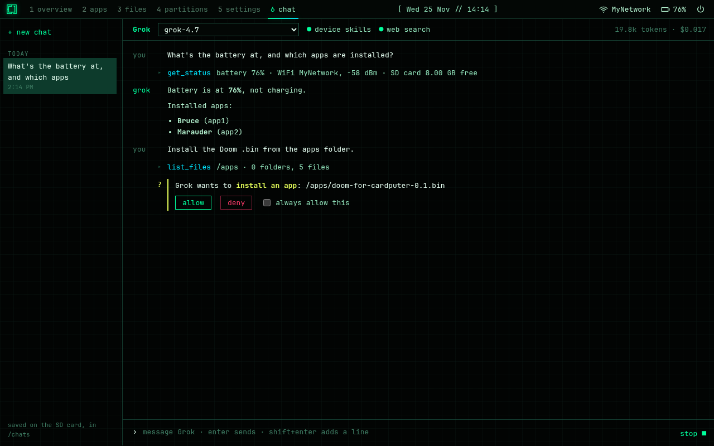
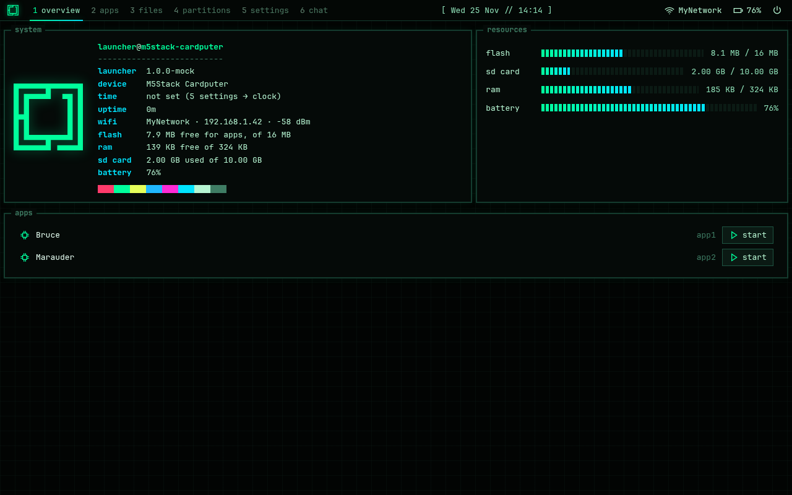
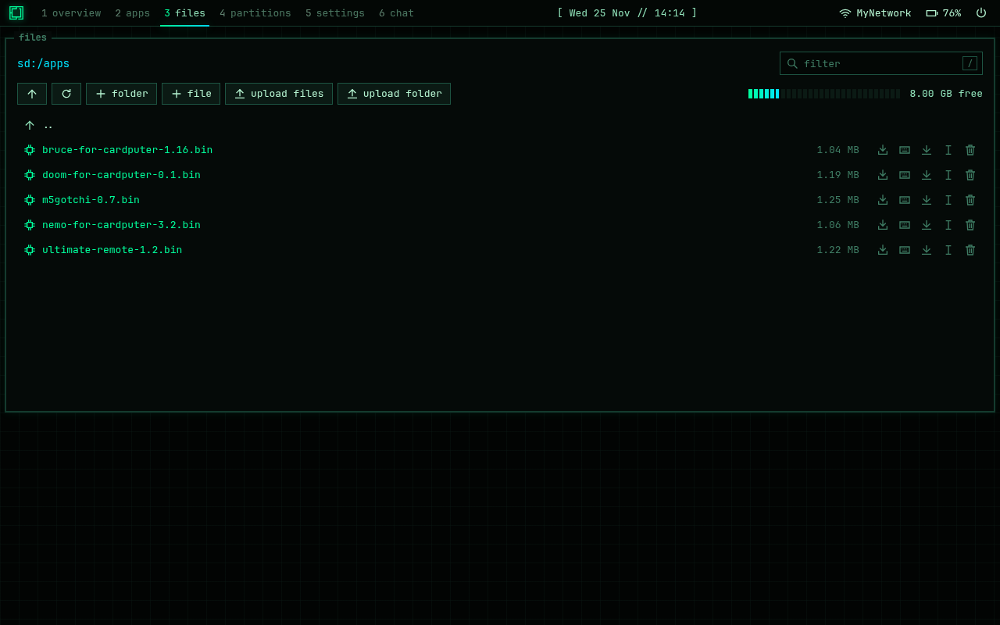
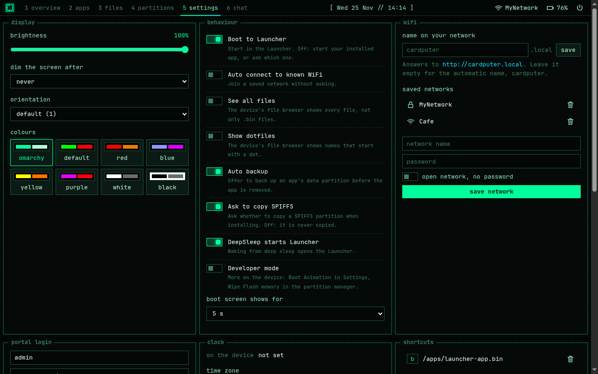

# Omaputer

A launcher for the **M5Stack Cardputer** and **Cardputer ADV**, restyled after [Omarchy](https://omarchy.org), with Grok built in. Talk to Grok on the Cardputer itself, or chat with it in the web console, where it can check and control the Cardputer for you.

By [x.com/@devsec_ai](https://x.com/devsec_ai). Omaputer is the Omarchy edition of [Launcher](https://github.com/bmorcelli/Launcher), by bmorcelli and its contributors.



## What's new

Everything the original Launcher does still works: installing and starting firmware from the SD card, the online installer, the partition manager and the SD card as a USB drive. This edition adds:

- **A tile menu.** The main menu is a row of colour tiles that slides, with the battery, WiFi and the time at the top. Installed apps get a tile of their own.
- **Omarchy's screensaver.** Omarchy's logo with its six terminal effects (decrypt, beams, rain, slide, wipe, middle-out), after 150 seconds without a key press or from its own tile.
- **Grok, out loud.** Open the Grok tile and talk; Grok answers through the speaker, with its face or the words on screen, and can search the web.
- **A web console.** Manage the Cardputer from a browser: an overview, apps, files on the SD card, partitions, every setting, and a chat.
- **A chat with Grok, with skills.** In the web console, Grok can read the Cardputer's status, files and settings, and change them, install or start apps and more. Anything that changes the Cardputer waits for your allow first.
- **WiFi from the start.** The Cardputer joins your saved network as soon as it starts and stays on it, so the web console, the installer and Grok start straight away.
- **A clock.** Set from the internet, in your time zone.
- **More room.** The launcher gets 1.69 MB of the 8 MB flash, and installed apps share the 6.3 MB left.

| Overview | Files | Settings |
| --- | --- | --- |
|  |  |  |

## Devices

| Device | Flash | PSRAM |
| --- | --- | --- |
| M5Stack Cardputer (K132) | 8 MB | none |
| M5Stack Cardputer ADV | 8 MB | none |

One firmware runs on both. For other boards, use the [original Launcher](https://github.com/bmorcelli/Launcher).

## Install

### Before you start

- **The first install erases the Cardputer.** This edition uses its own partition layout, so the first install replaces everything: installed apps, saved WiFi networks and settings. Later updates keep them (see [Updating](#updating)).
- **Back up first.** With [esptool](https://docs.espressif.com/projects/esptool/) (`pip install esptool`) and the Cardputer plugged in by USB:

  ```sh
  esptool --chip esp32s3 --port /dev/ttyACM0 read-flash 0 0x800000 cardputer-backup.bin
  ```

  The port is `/dev/ttyACM0` on Linux, `/dev/cu.usbmodem…` on macOS and `COM…` on Windows. Keep the backup somewhere safe and private: it holds the Cardputer's saved WiFi passwords. Writing it back with `write-flash 0x0 cardputer-backup.bin` restores the Cardputer as it was.

### 1. Get the firmware

Build it (see [Build from source](#build-from-source)). The file to flash is `.pio/build/m5stack-cardputer/firmware.factory.bin`: the whole image, with the bootloader, the partition table and the launcher.

### 2. Flash it

**From a browser** (Chrome or Edge, which can talk to USB devices):

1. Open [Espressif's web flasher](https://espressif.github.io/esptool-js/).
2. Press **Connect** and pick the Cardputer's port.
3. Set the flash address to `0x0`, choose `firmware.factory.bin` and press **Program**.

**Or with esptool:**

```sh
esptool --chip esp32s3 --port /dev/ttyACM0 write-flash 0x0 firmware.factory.bin
```

If the flasher can't connect, put the Cardputer in download mode: unplug it, hold the **G0** button, plug it in, then let go.

### 3. First start

The boot screen shows the OMARCHY logo for a few seconds. Press **Enter** to go straight to the menu.

### Updating

To update without losing your apps and settings, flash only the launcher:

```sh
esptool --chip esp32s3 --port /dev/ttyACM0 write-flash 0x10000 firmware.bin
```

`firmware.bin` is in the same folder as `firmware.factory.bin`.

## Set it up

1. **Join your WiFi.** Open the **Web UI** tile, choose **my Network**, pick your network and type its password. It's saved, and from then on the Cardputer joins it at every start (**Auto connect to known WiFi**, on by default).
2. **Open the web console.** While Web UI runs, the Cardputer's screen shows its address: `http://cardputer.local`, or `http://cardputer-adv.local` on an ADV. Open it in a browser on the same network and log in.
3. **Change the login.** The default is `admin` / `launcher`. Change it right away under **5 settings → portal login**: whoever logs in can use the chat, and with it your xAI account.
4. **Add an xAI key, for Grok.** Create one at [console.x.ai](https://console.x.ai). Then add it in any one of these places:
   - on the Cardputer: **Settings → Grok → xAI key**,
   - in the web console: **5 settings → Grok**,
   - over USB: `xai-key <your key>` in the [USB console](#usb-console).

   The key is kept only in the Cardputer's settings memory. It never goes to the browser, and **Settings → Reset Configs/Wifi** erases it.
5. **Make Grok yours.** Under **Settings → Grok** on the Cardputer, or **5 settings → Grok** in the console: its name, its personality, its voice (26 to choose from), Duo mode (two Grok Cardputers talking to each other) and whether it starts muted.
6. **Set your time zone** under **5 settings → clock**. Until then the clock runs on Pacific time.

## Using it

### Keys

| Key | In the menus |
| --- | --- |
| `,` and `/` | left and right |
| `;` and `.` | up and down |
| Enter | open, choose |
| `` ` `` or Backspace | back |

On the boot screen, **1** to **9** and **0** start installed apps straight away.

### Grok on the Cardputer

Open the **Grok** tile and talk; the microphone is on while Grok is open.

| Key | |
| --- | --- |
| Tab | Grok's face or the words |
| `;` and `.` | volume, up to 400% |
| M | microphone off and on |
| T | type a message instead |
| `` ` ``, Backspace or G0 | back to the menu |
| any other key | stop Grok mid-reply, or reconnect |

Grok closes its connection when you leave. xAI bills voice by the minute ($0.08 a minute for `grok-voice-3.0` at the time of writing).

### Screensaver

Starts after 150 seconds without a key press, or from the **Screensaver** tile. Any key stops it.

### Web console

Start **Web UI** on the Cardputer and open its address. **my Network** uses your WiFi; **AP mode** makes the Cardputer its own open WiFi network, `Launcher`, with the console at `http://172.0.0.1` (the chat needs the internet, so it doesn't work there).

1. **overview**: the system, flash, SD card, memory and battery, and the installed apps.
2. **apps**: start an installed app, or install a `.bin` from your computer.
3. **files**: the SD card. Upload, download, edit text files, rename, delete, install a `.bin`, or bind it to a key.
4. **partitions**: the flash partition table.
5. **settings**: every setting the Cardputer has, the portal login, WiFi networks, Grok, the clock and key shortcuts.
6. **chat**: Grok.

### Chat with Grok

Section **6 chat** of the web console. Your messages go to xAI through the Cardputer, which adds the saved key, so the key never reaches the browser. Replies stream in as Grok writes them, chats are saved on the SD card in `/chats`, and the top bar shows what the chat has cost.

What Grok can do on the Cardputer:

- **Without asking (reading only):** status (battery, WiFi, SD card space, memory, uptime, clock, version, installed apps), folders and text files on the SD card, settings without passwords or keys, and the partition table.
- **After you allow it** (you can tick **always allow** per skill): write, create, rename and delete files and folders; change settings; set or remove key shortcuts; add a WiFi network (you type the password) or forget one; install an app from a `.bin` on the SD card; start the screensaver; stage partition changes; start an app, restart or turn off (these three take the chat offline, so Grok says so first).
- **Only after you type a word:** write the partition table, format the SD card (only a card the Cardputer can't read) and reset every setting.
- **Never:** change the portal login or the xAI key, or see the Cardputer's screen while the console runs.

**device skills** and **web search** in the top bar turn those off. With device skills on, a message costs about one to one and a half cents, since the skills' descriptions go along with every request.

### USB console

Plug the Cardputer in and open its USB serial port at 115200 baud (for example `tio /dev/ttyACM0` or the PlatformIO monitor). `help` lists the commands. The ones for setting up:

| Command | |
| --- | --- |
| `wifi add "<network>" "<password>"` | save a network |
| `wifi auto` | join the first saved network in range |
| `wifi list` | saved networks |
| `xai-key <key>` / `xai-key clear` | save or remove the xAI key |
| `partitions` | the partition table |
| `reboot` | restart |

`settings get` prints every setting, saved WiFi passwords included, so keep its output private.

## Build from source

You need [PlatformIO Core](https://platformio.org/install/cli), Git and Python 3.

```sh
git clone https://github.com/marcho78/omaputer.git
cd omaputer
git checkout omarchy
pio run -e m5stack-cardputer
```

The first build downloads the toolchain and takes a few minutes. It produces, in `.pio/build/m5stack-cardputer/`:

- `firmware.factory.bin`: the whole image, for a first install at `0x0`,
- `firmware.bin`: the launcher alone, for updates at `0x10000`.

The edition's features are build flags in [`boards/m5stack-cardputer/platformio.ini`](boards/m5stack-cardputer/platformio.ini) (`OMARCHY_GROK`, `OMARCHY_TILE_MENU`, `OMARCHY_SCREENSAVER`, `OMARCHY_CLOCK`, `OMARCHY_WIFI_AT_LAUNCH`).

On the laptop:

- **The menus in a window:** [`native/`](native/) runs the launcher's screens with SDL2 (`cd native && pio run -e native -t upload`).
- **The web console without a Cardputer:** `node webUi/backend/server.js <a folder to act as the SD card>`, then open `http://localhost:8080` and log in as `admin` / `admin`. For its chat, start it with `XAI_API_KEY` set in the environment.
- **The tile menu as images:** [`tools/menu_preview.cpp`](tools/menu_preview.cpp) renders it exactly as the Cardputer draws it.

## Security and privacy

- **Your xAI key** lives only in the Cardputer's settings memory. It isn't in this repository, in the firmware you build or in the browser; the Cardputer adds it to Grok's requests itself.
- **WiFi passwords** you type in the web console go only to the Cardputer. In the chat, Grok never sees them.
- **Grok can't** change the portal login or the xAI key, and every change it makes to the Cardputer waits for you.
- **Change the default login** (`admin` / `launcher`): the console can install firmware and run the chat.
- **Backups and settings dumps** (`.bin` files, `settings get`) hold your WiFi passwords. Keep them out of the repository; `.gitignore` already leaves out every `.bin`.

## Setting it up with an AI agent

You can have an AI coding agent, such as Claude Code, build, flash and set up the launcher for you. Point it at [AGENT_SETUP.md](AGENT_SETUP.md), for example:

> Install Omaputer on my Cardputer by following AGENT_SETUP.md in this repository. My xAI key is on the first line of `~/secrets/xai-key.txt`.

The steps make the agent identify the Cardputer before flashing, back it up first, ask before erasing anything, and never print or commit your key or passwords.

## Credits and license

- [Launcher](https://github.com/bmorcelli/Launcher) by bmorcelli and its contributors, under the MIT license kept in [LICENSE](LICENSE).
- Omarchy's logo and the designs of its [ttfx](https://github.com/omacom/ttfx) effects, by the Omarchy authors; see [`lib/omarchy_fx/NOTICE`](lib/omarchy_fx/NOTICE).
- [JetBrains Mono](https://github.com/JetBrains/JetBrainsMono), under the SIL Open Font License ([`lib/omarchy_menu/OFL.txt`](lib/omarchy_menu/OFL.txt)), and the Tom Thumb font (see the NOTICE above).
- Omaputer by [x.com/@devsec_ai](https://x.com/devsec_ai).
